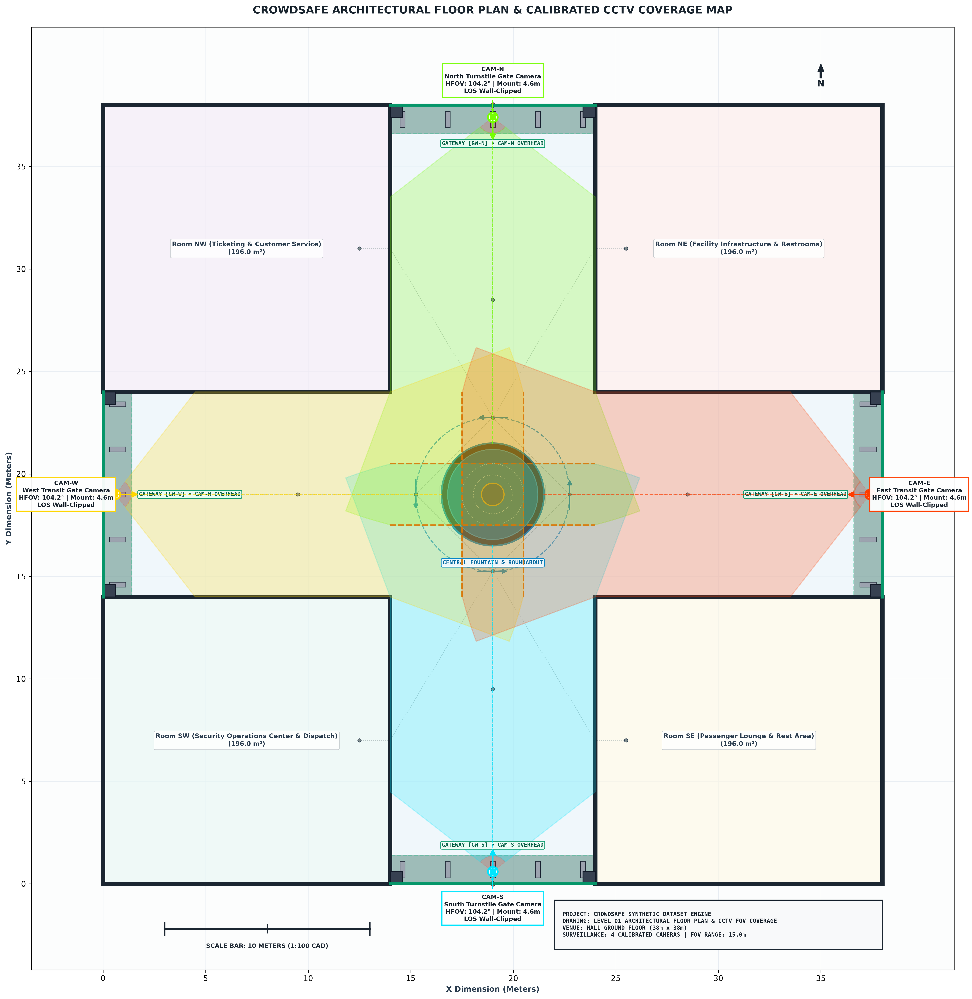
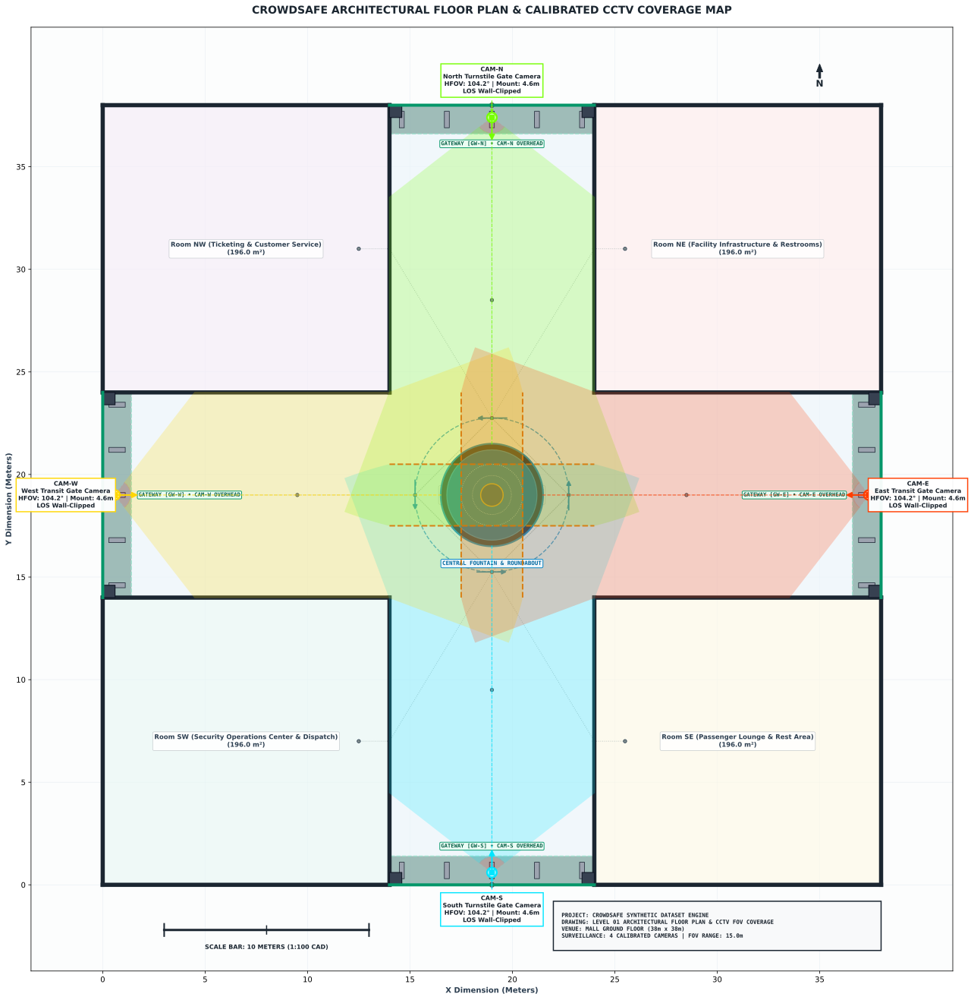

# Design 4: Controlled Transit Interchange
## Finalized Plus Walkway Floor Plan & CCTV Surveillance Catalog

---

## 1. Executive Summary & File Locations

This document serves as the finalized architectural, surveillance, and application asset specification for the **CrowdSafe Controlled Transit Interchange** (Design 4). It is consolidated and approved as the sole venue design for simulation, crowd physics, camera calibration, and web/dashboard reuse.

### Primary File & Application Asset Locations:
| Asset Target | File Path | Application / Usage Role |
| :--- | :--- | :--- |
| **Catalog Specification (Docs)** | [docs/plus_walkway_design_catalog.md](file:///run/media/mobeen/Projects/crowdsafe-fyp/docs/plus_walkway_design_catalog.md) | Central architectural documentation |
| **Catalog Specification (Venue)** | [dataset-generator/venue/floor_plans/plus_walkway_design_catalog.md](file:///run/media/mobeen/Projects/crowdsafe-fyp/dataset-generator/venue/floor_plans/plus_walkway_design_catalog.md) | Co-located specification in venue repository |
| **Dashboard Web App (PNG)** | [crowdsafe-dashboard/public/design_4_transit_interchange.png](file:///run/media/mobeen/Projects/crowdsafe-fyp/crowdsafe-dashboard/public/design_4_transit_interchange.png) | Served directly at `/design_4_transit_interchange.png` |
| **Dashboard Web App (SVG)** | [crowdsafe-dashboard/public/design_4_transit_interchange.svg](file:///run/media/mobeen/Projects/crowdsafe-fyp/crowdsafe-dashboard/public/design_4_transit_interchange.svg) | High-DPI scalable vector map for Next.js UI |
| **Dashboard Web App (JSON)** | [crowdsafe-dashboard/public/floor_plans/design_4_transit_interchange.json](file:///run/media/mobeen/Projects/crowdsafe-fyp/crowdsafe-dashboard/public/floor_plans/design_4_transit_interchange.json) | Web client JSON endpoint for zone overlays |
| **Python MVP Pipeline (PNG)** | [mvp/assets/design_4_transit_interchange.png](file:///run/media/mobeen/Projects/crowdsafe-fyp/mvp/assets/design_4_transit_interchange.png) | Default background map for OpenCV visualizer |
| **Python MVP Pipeline (JSON)** | [mvp/assets/design_4_transit_interchange.json](file:///run/media/mobeen/Projects/crowdsafe-fyp/mvp/assets/design_4_transit_interchange.json) | Zone coordinates for spatial risk analysis |
| **CAD Generator Tool** | [dataset-generator/tools/generate_plus_walkway_designs.py](file:///run/media/mobeen/Projects/crowdsafe-fyp/dataset-generator/tools/generate_plus_walkway_designs.py) | Parametric generation script |

---

## 2. Visual CAD Floor Plan & Calibration Map

Below is the verified 2D architectural blueprint with camera positions, ray-cast field-of-view (FOV) cones, speed-gate exit portals, and central fountain roundabout:



*Figure 1: High-resolution CAD map displaying $10.0\text{m}$ plus walkway, $14.0\text{m} \times 14.0\text{m}$ corner rooms with inward-opening doors, $\varnothing\,5.0\text{m}$ central fountain roundabout, 4 automated exit gateways, and 4 calibrated CCTV dome cameras achieving 83.8% optical concourse coverage.*

---

## 3. Reusing in Applications & Dashboards

### A. Next.js Web Dashboard (`crowdsafe-dashboard`)
The image and vector files are placed directly in the `public/` directory and can be referenced directly in any component or page:
```tsx
import Image from "next/image";

export function FloorPlanCard() {
  return (
    <div className="relative border rounded-xl overflow-hidden shadow-sm bg-neutral-900">
      <Image
        src="/design_4_transit_interchange.png"
        alt="CrowdSafe Transit Interchange 2D Floor Plan"
        width={1024}
        height={1024}
        className="w-full h-auto object-contain"
        priority
      />
    </div>
  );
}
```
Or as an SVG vector background:
```tsx

```

### B. Python MVP Pipeline (`mvp`)
Configured in `mvp/config.py`:
```python
# mvp/config.py
DEFAULT_FLOOR_PLAN = BASE_DIR / "assets" / "design_4_transit_interchange.png"
```
Used directly in OpenCV GUI visualizer and multi-layer compositors.

---

## 4. Architectural Layout Overview

```
                                NORTH EXIT (Y = 38m)
                     +-----------------------------------+
                     |         GATEWAY [GW-N]            |
                     |  CAM-N Mount (4.6m, Tilt 34°)     |
                     |  [====] [====] [====] [====]      |
                     +-----------------------------------+
                     |             WING_N                |
+--------------------+                                   +--------------------+
|                    |                                   |                    |
|      ROOM NW       |                                   |      ROOM NE       |
|    (Ticketing &    |                                   |  (Infrastructure & |
|  Customer Service) |                                   |     Restrooms)     |
|   14m x 14m        |                                   |   14m x 14m        |
|   (196.0 m²)       |                                   |   (196.0 m²)       |
|                    |             ROTARY_N              |                    |
|       Inward Door  [               (.)                 ]  Inward Door       |
+--------\-----------+                                   +-----------/--------+
|   GATEWAY [GW-W]   |         +---------------+         |   GATEWAY [GW-E]   |
|  CAM-W (4.6m)      |  ROT_W  | CLOCK FOUNTAIN|  ROT_E  |  CAM-E (4.6m)      |
|  [||] [||] [||]    |   (.)   |  ROUNDABOUT   |   (.)   |    [||] [||] [||]  |
|  WEST EXIT (X=0m)  |         | r=2.5m (19.6m²)|        |  EAST EXIT (X=38m) |
+--------/-----------+         +---------------+         +-----------\--------+
|       Inward Door  [               (.)                 ]  Inward Door       |
|                    |             ROTARY_S              |                    |
|      ROOM SW       |                                   |      ROOM SE       |
|  (Security Ops &   |                                   |    (Passenger      |
|   Dispatch Hub)    |                                   |  Lounge & Rest)    |
|   14m x 14m        |                                   |   14m x 14m        |
|   (196.0 m²)       |                                   |   (196.0 m²)       |
|                    |             WING_S                |                    |
+--------------------+                                   +--------------------+
                     |         GATEWAY [GW-S]            |
                     |  CAM-S Mount (4.6m, Tilt 34°)     |
                     |  [====] [====] [====] [====]      |
                     +-----------------------------------+
                                SOUTH EXIT (Y = 0m)
```

### Key Dimensional Parameters:
* **Footprint**: $38.0\text{m} \times 38.0\text{m}$ square perimeter ($1,444.0\,\text{m}^2$ total gross floor area).
* **Concourse Conformation**: $10.0\text{m}$ wide central plus-shaped walkway ($660.0\,\text{m}^2$ gross walkway, **$640.4\,\text{m}^2$ net walkable concourse**).
* **Corner Rooms**: 4 corner rooms ($14.0\text{m} \times 14.0\text{m}$, $196.0\,\text{m}^2$ each):
  - **Room SW**: Security Operations Center & Dispatch Hub
  - **Room SE**: Passenger Lounge & Rest Area
  - **Room NW**: Ticketing & Customer Service Concourse
  - **Room NE**: Facility Infrastructure, Electrical & Restrooms
* **Inward-Opening Doors**: 4 / 4 commercial magnetic security doors ($1.2\text{m}$ width), swinging strictly $90^\circ$ inward into room chambers, maintaining **0.0% corridor protrusion/obstruction**.
* **Central Feature**: $\varnothing\,5.0\text{m}$ ($r = 2.5\text{m}$, area $19.6\,\text{m}^2$) Rotary Clock Tower Fountain acting as an architectural pedestrian roundabout with a **$2.5\text{m}$ clear counter-clockwise circulation lane**.

---

## 5. Architectural Exit Gateways

Each of the 4 perimeter exit portals ($10.0\text{m}$ clear span) is equipped with a high-capacity egress/ingress security gateway:

| Gateway ID | Direction | Portal Span | Number of Lanes | Clear Lane Width | Emergency Throughput | Camera Overhead Integration |
| :--- | :--- | :--- | :---: | :---: | :---: | :--- |
| `GW-S` | South ($Y = 0.0\text{m}$) | $X \in [14.0, 24.0]$ | 4 Lanes | $2.0\text{m}$ (ADA compliant) | $520\text{ persons/min}$ | `CAM-S` overhead gantry mount ($Z = 4.6\text{m}$) |
| `GW-N` | North ($Y = 38.0\text{m}$) | $X \in [14.0, 24.0]$ | 4 Lanes | $2.0\text{m}$ (ADA compliant) | $520\text{ persons/min}$ | `CAM-N` overhead gantry mount ($Z = 4.6\text{m}$) |
| `GW-W` | West ($X = 0.0\text{m}$) | $Y \in [14.0, 24.0]$ | 4 Lanes | $2.0\text{m}$ (ADA compliant) | $520\text{ persons/min}$ | `CAM-W` overhead gantry mount ($Z = 4.6\text{m}$) |
| `GW-E` | East ($X = 38.0\text{m}$) | $Y \in [14.0, 24.0]$ | 4 Lanes | $2.0\text{m}$ (ADA compliant) | $520\text{ persons/min}$ | `CAM-E` overhead gantry mount ($Z = 4.6\text{m}$) |

### Structural & Safety Details:
1. **Structural Terminal Jamb Pillars**: $0.6\text{m} \times 0.6\text{m}$ reinforced concrete jambs anchoring each side of the portal.
2. **Floor Threshold Matting**: $1.4\text{m}$ deep high-traction transition floor zone with directional tactile tread lines.
3. **Turnstile Array**: 5 stainless steel optical flap-barrier stanchions dividing the 4 lanes with bi-directional LED indicator lights.
4. **Emergency Fail-Safe Egress**: Automatic drop-arm breakout on alarm trigger, yielding **$2,080\text{ persons/min}$** total venue emergency evacuation capacity.

---

## 6. Calibrated CCTV Surveillance Array

Four wide-angle surveillance dome cameras are mounted directly on the overhead gateway canopy gantries at $4.6\text{m}$ elevation:

| Camera ID | Gateway Position | 3D Coordinates $(X, Y, Z)$ | Azimuth Heading | Downward Tilt | Bounded Range | Walkable Coverage |
| :--- | :--- | :--- | :--- | :--- | :--- | :--- |
| `CAM-S` | Over Gateway `GW-S` | $(19.0\text{m}, 0.5\text{m}, 4.6\text{m})$ | $90.0^\circ$ (North) | $34.0^\circ$ | $20.5\text{m}$ (DORI) | $45.2\%$ concourse |
| `CAM-N` | Over Gateway `GW-N` | $(19.0\text{m}, 37.5\text{m}, 4.6\text{m})$ | $270.0^\circ$ (South) | $34.0^\circ$ | $20.5\text{m}$ (DORI) | $45.2\%$ concourse |
| `CAM-W` | Over Gateway `GW-W` | $(0.5\text{m}, 19.0\text{m}, 4.6\text{m})$ | $0.0^\circ$ (East) | $34.0^\circ$ | $20.5\text{m}$ (DORI) | $45.2\%$ concourse |
| `CAM-E` | Over Gateway `GW-E` | $(37.5\text{m}, 19.0\text{m}, 4.6\text{m})$ | $180.0^\circ$ (West) | $34.0^\circ$ | $20.5\text{m}$ (DORI) | $45.2\%$ concourse |

### Surveillance Performance Metrics:
* **Net Walkable LOS Coverage**: **83.8%** ($536.7\,\text{m}^2$ of the $640.4\,\text{m}^2$ net walkable floor illuminated by calibrated CCTV optics). Target $\ge 80\%$ is **PASSED**.
* **Central Overlap**: **18.8%** multi-camera cross-monitoring coverage over the central fountain roundabout.
* **Strict Wall Occlusion**: 100% ray-casting against 16 opaque perimeter and corner walls (**0.0% ray penetration into rooms**).
* **Nadir Dead Zone**: Authentic $1.9\text{m}$ blind zone directly beneath camera headers before floor frustum intersection.
* **Optical Handover Boundary**: Perpendicular corridor midline $\pm 1.5\text{m}$ handoff preventing cross-corridor optical degradation.
