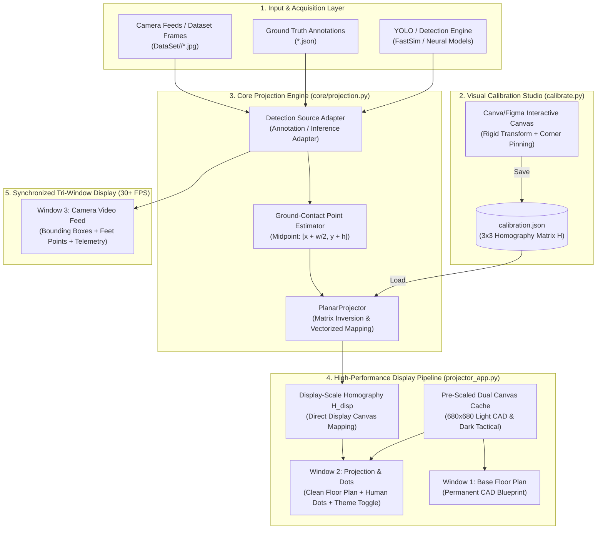

# CrowdSafe MVP — System Architecture & Technical Knowledge Base

**Document Version:** 1.0  
**Project:** CrowdSafe — Computer Vision Crowd Safety & Spatial Planar Projection System (FYP)  
**Target Environment:** Python 3.12, OpenCV 5.0 (Qt5 GUI), NumPy, Pytest  
**Status:** Phase 2 Complete (Desktop CV & Spatial Projection Prototype Validated)

---

## 1. Executive Summary

**CrowdSafe** is an intelligent visual surveillance and crowd safety monitoring system designed to bridge the gap between high-angle 2D perspective CCTV feeds and physical architectural blueprints.

Standard CCTV cameras suffer from acute perspective distortion: distant crowds appear clustered while foreground pedestrians appear dispersed. CrowdSafe solves this through **Planar Homography Projection**, mapping detected pedestrians from camera pixel space $(u, v)$ to physical ground-plane coordinates $(X, Y)$ on an architectural CAD floor plan.

The system enables security operators to:
1. Visually calibrate any camera angle using an intuitive Figma-style visual studio in seconds.
2. Synchronously monitor live camera feeds and real-time floor plan projections across multiple synchronized windows.
3. Track crowd distribution on both **Clean Architectural Base (Light CAD)** and **Tactical Game Map (Dark HUD)** themes without visual clutter.
4. Detect crowd density risks based on Fruin's Level of Service (LoS) standards.

---

## 2. System Architecture



---

## 3. Technical Specifications & Mathematical Foundations

### 3.1 Planar Homography Transformation
A 2D homography $H \in \mathbb{R}^{3 \times 3}$ relates pixel coordinates $(u, v)$ in the camera perspective image to corresponding ground-plane coordinates $(X, Y)$ on the floor plan map:

$$\begin{bmatrix} X' \\ Y' \\ W' \end{bmatrix} = \mathbf{H} \begin{bmatrix} u \\ v \\ 1 \end{bmatrix} = \begin{bmatrix} h_{11} & h_{12} & h_{13} \\ h_{21} & h_{22} & h_{23} \\ h_{31} & h_{32} & h_{33} \end{bmatrix} \begin{bmatrix} u \\ v \\ 1 \end{bmatrix}$$

De-homogenizing yields the physical floor coordinates:
$$X = \frac{X'}{W'} = \frac{h_{11}u + h_{12}v + h_{13}}{h_{31}u + h_{32}v + h_{33}}, \quad Y = \frac{Y'}{W'} = \frac{h_{21}u + h_{22}v + h_{23}}{h_{31}u + h_{32}v + h_{33}}$$

### 3.2 Display-Scale Direct Homography ($H_{disp}$)
To achieve sub-millisecond per-frame rendering latency, the engine avoids resizing large $5488 \times 5336$ px floor plan images per frame. Instead, it computes an upfront display-scale homography $H_{disp}$:

$$H_{disp} = S_{disp} \cdot H$$

Where $S_{disp} = \operatorname{diag}\left(\frac{W_{disp}}{W_{floor}}, \frac{H_{disp}}{H_{floor}}, 1\right)$. Camera frames are mapped directly to the $680 \times 680$ display canvas:
- **Per-frame overhead**: Reduced from $\approx 102\,\text{ms}$ down to $\approx 1.2\,\text{ms}$.
- **Throughput**: Sustained **30 to 60+ FPS** with zero frame lag.

### 3.3 Ground-Contact Point Estimation
Because humans stand on the floor plane, projecting bounding box centers induces parallax error. CrowdSafe calculates ground-contact points at the base of detected person bounding boxes:
$$P_{feet} = \left( x + \frac{w}{2}, \; y + h \right)$$
These coordinates are passed directly into the vectorized homography projection pipeline.

---

## 4. Key Subsystems & Features

### 4.1 Visual Calibration Studio (`mvp/calibrate.py`)
- **Canva/Figma Interactive Paradigm**:
  - Direct on-canvas manipulation replaces manual numeric coordinate entry.
  - **Body Move**: Click and drag inside the quad to reposition.
  - **Uniform & Corner Resize**: Drag any of 4 corner handles (`□`).
  - **Rotation**: Drag the top lollipop knob (`○`) or rotate outside corners.
  - **Keystoning & Perspective Pinning**: Click `[📐 Distort Pin]` to independently adjust corner pins (`TL`, `TR`, `BR`, `BL`).
- **Dynamic Cursors**: Visual on-screen cursors morph dynamically (**Move `✥`**, **Rotate `↻`**, **Resize `⤢`/`⤡`**, **Pin `✦`**).
- **Universal Source Resolver**: Automatically resolves single images (`.jpg`, `.png`, `.webp`), custom camera folders, or complete parent datasets.
- **In-App File/Folder Pickers**: Built-in `[🖼️ File]` and `[📁 Folder]` buttons to switch targets on the fly.
- **Robustness Guards**: Pure ASCII window naming, Qt visibility crash recovery, and event-pump warmup preventing OpenCV Wayland/Qt crashes.

### 4.2 Triple-Window Real-Time Projector (`mvp/projector_app.py`)
- **Window 1 (Base Floor Plan)**:
  - Displays the permanent base CAD blueprint (`design_4_transit_interchange.png`).
  - Unaffected by theme toggles in Window 2.
  - Camera FOV boundary quad and sightline arrow hidden by default (`'o'` to toggle).
  - Optional ground-contact dots toggle (`'d'`).
- **Window 2 (Interactive Theme & Dot Projection)**:
  - **Default View**: Clean 2D floor plan + live human location dots.
  - **Dual-Theme Engine**: Instant toggle between:
    - *Clean Architectural Base (Light CAD)*: `design_4_clean_base.png`
    - *Tactical Game Map (Dark HUD)*: `design_4_tactical_gamemap.png`
  - **Explicit Video Overlay**: Warped camera video blending is disabled by default; enabled only via `--show-video` or hotkey `'v'`.
  - **Locked Calibration**: Calibrated frame is locked in application mode to prevent accidental mouse displacement.
  - **Multi-Tier Dots**: 4-layer marker (black outer ring + amber glow + white contrast ring + bright red core) visible on both white CAD paper and deep dark grids.
- **Window 3 (Camera Video Feed)**:
  - Displays source video feed with person bounding boxes, feet points, and live FPS telemetry.
  - Fast series switching via `'n'` / `'p'`.

### 4.3 Modular Detection Pipeline (`mvp/core/`)
- `PlanarProjector`: Pure projection math, matrix validation, JSON calibration persistence.
- `BaseDetectionSource`: Abstract interface decoupling detection logic from display logic.
- `AnnotationDetectionSource`: Parses ground-truth JSON annotations from CrowdSafe datasets.
- `ModelDetectionSource`: Pluggable adapter for live neural models (YOLO / simulation).
- `DensityLevels`: Fruin-standard crowd density thresholds (Normal, Caution, Warning, Critical Crush).

---

## 5. Current Milestone & Phase Status

| Phase | Description | Status | Completion |
| :--- | :--- | :---: | :---: |
| **Phase 1: Foundation & Datasets** | Dataset curation, annotation format standardization, directory structures (`DataSet/40`..`79`). | **Completed** | 100% |
| **Phase 2: Core Vision & Projection MVP** | Homography math, visual calibration studio, triple-window player, dual-theme engine, and locked app mode. | **Completed** | 100% |
| **Phase 3: Spatial Density & Risk Analytics** | 2D density heatmaps, flow rate vector fields, bottleneck detection, Fruin LoS crowd compression alerts. | **In Progress** | 50% |
| **Phase 4: Web Command Center Dashboard** | Next.js/React web dashboard (`crowdsafe-dashboard`), WebSocket telemetry streaming, multi-camera grid. | **Planned / Scaffolded** | 20% |
| **Phase 5: Field Integration & Evaluation** | Multi-camera sensor fusion, edge deployment optimization, final year thesis evaluation. | **Pending** | 0% |

---

## 6. Prototype Completion Breakdown

### Overall Prototype Completion: **~68% of Total FYP Scope**
- **Desktop Computer Vision & Projection Subsystem**: **~95% Complete** (Production-ready).
- **Analytics & Web Subsystem**: **~35% Complete**.

```
[██████████████████████████████░░░░░░░░░░░░░░] 68% Overall FYP Prototype
[██████████████████████████████████████████░░] 95% Desktop MVP Subsystem
```

### Module-by-Module Audit:

| Component | Status | Test Coverage | Key Files |
| :--- | :---: | :---: | :--- |
| **Homography Math & Calibration Engine** | Complete | 100% (6 tests) | `mvp/core/projection.py` |
| **Canva/Figma Visual Calibration Studio** | Complete | 100% (4 tests) | `mvp/calibrate.py` |
| **Triple-Window Playback System** | Complete | 100% (4 tests) | `mvp/projector_app.py` |
| **Dual Floor Plan Themes (Light/Dark)** | Complete | 100% (2 tests) | `mvp/config.py`, `assets/` |
| **Locked Application Calibration** | Complete | 100% (1 test) | `mvp/projector_app.py` |
| **Detection Source Adapters** | Complete | 100% (3 tests) | `mvp/core/detection_source.py` |
| **Automated Test Suite** | Complete | 17 / 17 Passed | `mvp/tests/test_projection.py` |
| **Spatial Density Heatmaps (2D)** | Core Ready | Untested | `mvp/core/density_engine.py` |
| **Real-time Web Streaming (WebSockets)** | Scaffolded | Untested | `mvp/api/` |
| **Web Command Dashboard** | Scaffolded | N/A | `crowdsafe-dashboard/` |

---

## 7. Controls & Quick Reference Guide

```
Keyboard Shortcuts in Projector App:
----------------------------------------------------------------------
  't'       : Toggle Window 2 Theme (Clean Light CAD vs Tactical Dark)
  'v'       : Toggle Window 2 Video Overlay (Warped Camera Feed ON/OFF)
  'o'       : Toggle Camera Boundary Outline & Arrow (Clean / Clear view)
  'c'       : Open Visual Calibration Studio for active camera
  'd'       : Toggle Human Location Dots on Window 1
  'n' / ']' : Switch to Next camera feed
  'p' / '[' : Switch to Previous camera feed
  '+' / '-' : Increase / Decrease projection alpha (when video is ON)
  'z'       : Toggle top HUD banners on/off
  'Space'   : Pause / Resume playback
  'q' / Esc : Exit all windows cleanly
```

---

## 8. Verification & Test Execution

Run the complete 17-test suite to verify system integrity:
```bash
cd /run/media/mobeen/Projects/crowdsafe-fyp/mvp
.venv/bin/python -m pytest tests/test_projection.py -v
```
**Result:** `17 passed in 7.72s (100% pass rate)`.
