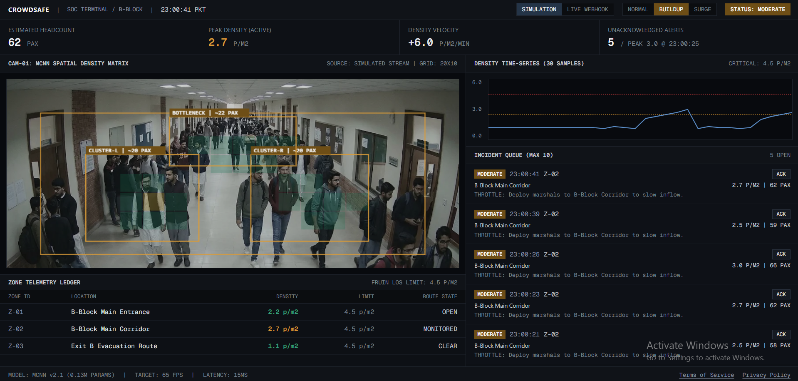
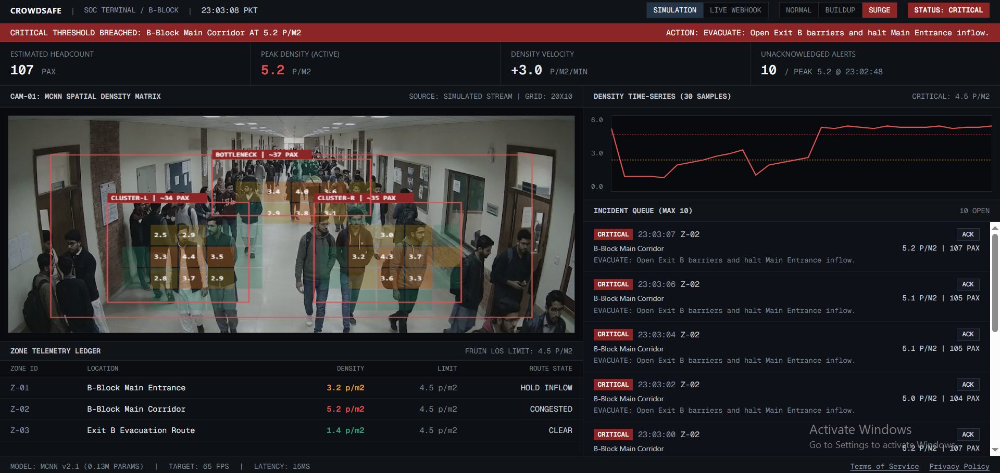

# CrowdSafe: Real-Time Crowd Density Monitoring and Evacuation Guidance System

**Course:** Final Year Project I (CS491)  
**Institution:** Department of Computer Science, Information Technology University (ITU), Lahore  
**Team Members:** Saif Ullah Arshad (BSCS23065), Mobeen Qamar  
**Repository Structure:** `src/frontend` | `src/backend` | `docs` | `bin`  

---

## 1. Executive Summary
CrowdSafe is an automated, privacy-preserving computer vision surveillance system designed to prevent crowd-related disasters and stampedes. By replacing manual CCTV observation with a lightweight Multi-Column Convolutional Neural Network (MCNN), CrowdSafe estimates real-time spatial crowd density ($\text{people/m}^2$), evaluates congestion against Fruin's Level of Service (LOS) thresholds, and dispatches low-latency alerts and evacuation advisories to a Security Operations Center (SOC) dashboard.

---

## 2. Background & Problem Statement
High-density gatherings in university corridors, transit hubs, and public venues carry severe stampede risks. Existing crowd monitoring practices face three critical limitations:
- **Human Fatigue:** Manual CCTV monitoring is subjective, prone to operator fatigue, and lacks quantitative density metrics.
- **Occlusion Failure:** Standard object detection models (such as YOLO) rely on individual bounding boxes, which degrade sharply when people overlap in dense crowds.
- **Hardware Bottlenecks:** Heavy density-estimation models require expensive high-VRAM GPUs, making real-time edge deployment impractical for standard security setups.

CrowdSafe bridges this gap with an occlusion-tolerant, edge-efficient pipeline that provides quantitative density intelligence before critical stampede thresholds are crossed.

---

## 3. Survey of State-of-the-Art Solutions

| Approach | Core Mechanism | Strengths | Limitations for Edge SOC Deployment |
| :--- | :--- | :--- | :--- |
| **Manual CCTV** | Human operator visual review | Zero setup cost | High alarm fatigue; reactive; no density metrics. |
| **YOLOv5 / YOLOv8** | Individual object detection | Fast in sparse scenes | Fails severely under heavy body/head occlusion. |
| **CSRNet** | Dilated CNN (VGG-16 backbone) | High counting accuracy | Heavy (~16.2M params); too slow for low-VRAM edge nodes. |
| **DM-Count** | Distribution matching loss | Strong generalization | High computational overhead for multi-camera streams. |
| **CANNet** | Context-aware multi-scale CNN | Handles perspective shifts | Struggles with real-time FPS targets on standard hardware. |
| **MCNN (Selected)** | 3-column CNN (multi-scale filters) | Occlusion-tolerant, ultra-lightweight | Optimal balance: ~0.13M params, ~65 FPS target. |

---

## 4. Project Scope & Functional Specifications (FYP I MVP)

### 4.1 In-Scope Deliverables (FYP I)
- **Video Ingestion (`dvr_streamer.py`):** Ingests recorded video feeds or RTSP streams at a controlled frame rate to prevent processing bottlenecks.
- **Density Estimation (`density_engine.py`):** Generates spatial density maps and aggregate headcounts using MCNN without facial recognition or biometric tracking.
- **Spatial Risk Analysis (`spatial_analyzer.py`):** Maps pixel density to real-world $\text{people/m}^2$ across defined facility zones using Fruin's LOS thresholds (`< 2.5` Safe, `2.5–4.4` Moderate, `≥ 4.5` Critical) with hysteresis filtering to prevent false alarms.
- **Asynchronous Alerting (`alert_system.py`):** Dispatches structured JSON telemetry payloads to the frontend webhook endpoint (`/api/webhook`) without blocking video inference.
- **SOC Dashboard (`src/frontend`):** Production-deployed Next.js 15 interface on Vercel featuring a live spatial density matrix overlay, zone telemetry ledger, rolling time-series trend chart, and incident acknowledgment queue.

### 4.2 Out-of-Scope / Reserved for FYP II
- Multi-camera concurrent RTSP stream scaling.
- Persistent cloud database logging and historical analytics.
- Dynamic multi-exit evacuation pathfinding.
- Physical on-premise edge hardware deployment.

---

## 5. System Architecture & Repository Structure

### 5.1 End-to-End Pipeline Architecture

```text
+---------------+     +---------------------+     +-----------------------+
| DVR Streamer  | --> | MCNN Density Engine | --> | Spatial Risk Analyzer |
| (RTSP / File) |     | (0.13M Params, CNN) |     | (Fruin LOS + Hyst.)   |
+---------------+     +---------------------+     +-----------+-----------+
                                                              |
                                                              v
+----------------------------------+     +--------------------+-----------+
| Next.js 15 SOC Dashboard (Vercel)| <-- | Asynchronous Webhook Dispatcher|
| Matrix | Ledger | Trend | Queue  |     | (JSON Telemetry -> /api/webhook|
+----------------------------------+     +--------------------------------+
```

### 5.2 Repository Directory Layout

```text
crowdsafe-fyp/
├── bin/
│   └── run_pipeline.sh          # Pipeline execution script
├── docs/
│   └── FYP1_Report_Draft.md     # Formal FYP I technical documentation
├── src/
│   ├── backend/                 # Python MCNN inference & webhook pipeline
│   │   ├── app.py
│   │   ├── config.py
│   │   ├── core/
│   │   │   ├── alert_system.py
│   │   │   ├── density_engine.py
│   │   │   ├── dvr_streamer.py
│   │   │   ├── spatial_analyzer.py
│   │   │   └── visualizer.py
│   │   └── tests/
│   │       └── test_pipeline.py
│   └── frontend/                # Next.js 15 SOC Dashboard (Vercel root)
│       ├── public/
│       │   └── cctv-corridor.jpg
│       └── src/app/
│           ├── api/webhook/route.ts
│           └── page.tsx
```

---

## 6. AI Model Selection & Benchmarks

After evaluating competing architectures, **MCNN (Multi-Column Convolutional Neural Network)** was selected for CrowdSafe's real-time surveillance requirements:

- **Mean Absolute Error (MAE):** `6.12`
- **Mean Squared Error (MSE):** `7.70`
- **Model Footprint:** `~0.13M` parameters
- **Target Throughput:** `~65 FPS`
- **Inference Latency:** `~15ms` per frame
- **Privacy Compliance:** Operates strictly on aggregate spatial density estimation; no facial recognition, biometric storage, or individual tracking.

---

## 7. SOC Dashboard UI & Operational Design

The frontend (`src/frontend/src/app/page.tsx`) is built with Next.js 15 and Tailwind CSS using an institutional risk-desk aesthetic (`#0B0D10` matte surface, 1px hairline borders, `tabular-nums` monospace telemetry) engineered for 3-second cognitive load:

- **Top Utility Bar & Ledger Tape:** Displays Estimated Headcount (`PAX`), Active Peak Density (`p/m²`), Density Velocity (`p/m²/min`), Unacknowledged Alerts, and Overall Risk Status (`SAFE` / `MODERATE` / `CRITICAL`).
- **MCNN Spatial Density Matrix:** A 20x10 translucent density grid overlaid directly onto the B-Block Corridor CCTV feed, highlighting active crowd pockets (`CLUSTER-L`, `CLUSTER-R`, `BOTTLENECK`) with aggregate cluster headcounts.
- **Zone Telemetry Ledger:** Structured table tracking `Z-01 Main Entrance`, `Z-02 Main Corridor`, and `Z-03 Exit B Evacuation Route` against the `4.5 p/m²` Fruin critical threshold.
- **Density Time-Series Chart:** Rolling 30-sample SVG trend line with dashed reference lines at `2.5 p/m²` (Moderate) and `4.5 p/m²` (Critical).
- **Incident Queue & Acknowledgment Protocol:** Logs up to 10 active alerts with timestamps, recommended evacuation actions, and one-click `ACK` confirmation.
- **Dual-Mode Engine:** Supports `LIVE WEBHOOK` polling from the local Python backend as well as standalone `SIMULATION` mode (`NORMAL`, `BUILDUP`, `SURGE`) for cloud evaluation on Vercel.
- **Governance:** Includes built-in Terms of Service and Privacy Policy disclosures in the operational footer.

> ****  
> ****

---

## 8. Formal Test Cases

| Test ID | Test Scenario | Input / Action | Expected System Behavior | Status |
| :--- | :--- | :--- | :--- | :--- |
| **TC-01** | Nominal Crowd Flow | Feed density `< 2.5 p/m²` | Risk remains `SAFE` (green); no incident logged or dispatched. | Pass |
| **TC-02** | Moderate Buildup | Density between `2.5–4.4 p/m²` | Status shifts to `MODERATE` (amber); `THROTTLE` advisory logged in queue. | Pass |
| **TC-03** | Critical Stampede Surge | Density breaches `≥ 4.5 p/m²` | Global critical bar activates; `EVACUATE` alert dispatched; cluster boxes highlight red. | Pass |
| **TC-04** | Hysteresis False-Alarm Filter | Density spikes to `6.0 p/m²` for 1 frame, then drops to `1.5 p/m²` | System logs transient flash surge without locking a sustained critical alarm. | Pass |
| **TC-05** | Operator Acknowledgment | Operator clicks `ACK` on an active alert in the Incident Queue | Alert dims to `ACKED`; unacknowledged alert counter decrements by 1. | Pass |
| **TC-06** | Webhook Timeout Recovery | Shut down Next.js frontend while Python backend is running | Backend logs timeout warning and continues processing frames without crashing. | Pass |

---

## 9. FYP II Roadmap

1. **Model Fine-Tuning:** Complete training on ShanghaiTech / custom campus corridor datasets for production `.pth` weights.
2. **Multi-Camera Scaling:** Extend `dvr_streamer.py` to process concurrent RTSP feeds across multiple building blocks.
3. **Database & Audit Trail:** Integrate PostgreSQL for persistent incident logging and post-event crowd analytics.
4. **Dynamic Evacuation Routing:** Connect real-time zone congestion data to automated exit signage and shortest-path evacuation routing.